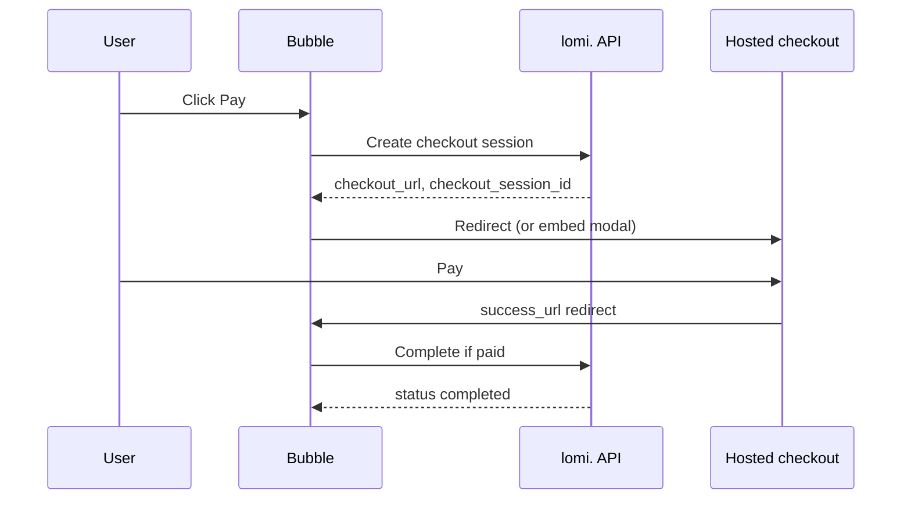

# Bubble plugin setup guide

## 1. Create and sync the plugin

1. Go to [bubble.io/home/plugins](https://bubble.io/home/plugins) and create a plugin named **lomi.**
2. Open the plugin → **Settings / Version** → **Synchronize with GitHub**.
3. Connect this repo (`lomiafrica/bubble`). On first sync, Bubble may assign its own plugin ID, keep the folder structure intact when merging.
4. In the **Shared** tab, set **Plugin API version** to **4**.
5. Upload **Shared → Assets** from `assets/images/` and `assets/js/` if CDN URLs are not yet assigned.

> GitHub sync for marketplace plugins may require a seller account. For private plugins you can still copy action/element code into the Editor manually.

## 2. Configure keys in your Bubble app

Install the plugin on your app, then open **Plugins → lomi.**:

| Field | Development (test) | Production (live) |
|-------|-------------------|-------------------|
| API Secret Key | `lomi_sk_test_…` | `lomi_sk_live_…` |
| Webhook secret | `whsec_…` (test endpoint) | `whsec_…` (live endpoint) |

Server actions pick `sandbox.api.lomi.africa` vs `api.lomi.africa` from the key prefix automatically.

## 3. Hosted checkout workflow (recommended)



### Workflow steps

1. **Build checkout URLs** (optional), generates `success_url` / `cancel_url` with `thing_id` and `session_id` query params.
2. **Create checkout session** (server)
   - `amount`: XOF whole francs; USD/EUR major units (converted to cents server-side). Omitted when `line_items_json` is set.
   - `currency_code`: `XOF`, `USD`, or `EUR`
   - `success_url` / `cancel_url`: Bubble page URLs
   - `bubble_thing_type`, `bubble_thing_id`, `bubble_page`: stored in metadata for webhooks
   - Optional: customer address fields, `line_items_json`, `metadata_json`
3. **Mark checkout redirect** (client), call before redirect (pay button does this automatically).
4. **Redirect to checkout** (client), pass `checkout_url` from step 2  
   **OR** use the **lomi. Pay button** element with `checkout_url` bound to step 2’s result.
5. **Success page**: canonical workflow:
   - Read `session_id` from URL (`Get data from page URL`)
   - **Complete if paid** → if `paid` is no, run **Abandon checkout** (client + server)
   - If `paid` is yes → mark Thing paid, show confirmation

### Example success URL

Use **Build checkout URLs** or configure manually:

```
https://yourapp.bubbleapps.io/version-test/checkout_success?thing_id=<id>&session_id={CHECKOUT_SESSION_ID}
```

Bubble replaces `{CHECKOUT_SESSION_ID}` when the session is created if you pass that literal in `success_url`.

## 4. Cancel and abandon

| Step | Action |
|------|--------|
| User cancels on hosted checkout | Lands on `cancel_url` → run **Abandon checkout** (client) + optional server action |
| Browser back after redirect | `checkout-abandon.js` in page headers fires `lomi:checkout-abandon` |
| Success page but not paid | **Complete if paid** returns `paid = no` → **Abandon checkout** |

Listen for `lomi:checkout-abandon` with a **JavaScript to Bubble** event or run a workflow from the cancel page.

## 5. Webhooks

See **[WEBHOOK_WORKFLOW.md](./WEBHOOK_WORKFLOW.md)** for the full API workflow.

Summary:

1. Expose backend workflow as POST API.
2. **Verify and parse webhook** with raw body + `X-Lomi-Signature`.
3. Branch on `PAYMENT_SUCCEEDED` → **On payment succeeded** → update Thing (idempotent).
4. Branch on `REFUND_COMPLETED` → **On refund completed** → mark refunded / add note.

## 6. Pay button element

Drag **lomi. Pay button** onto the page:

| Property | Description |
|----------|-------------|
| Checkout URL | `checkout_url` from create session step |
| Button text | Label (default: “Pay with lomi.”) |
| Use image button | Show `pay-with-lomi.webp` CTA |
| Show secured badge | `secured-by-lomi.webp` below button |
| Checkout mode | `redirect` (default) or `embed` |

Events: `onclick`, `oncomplete` (embed), `onerror`.

Embed completion also dispatches `lomi:checkout-complete` on `window`.

## 7. Checkout branding element

**lomi. Checkout branding**: read-only row of payment method icons + secured badge for checkout pages (PrestaShop/Woo parity).

## 8. Embed mode

`assets/js/lomi-embed.js` is bundled from `@lomi./embed`. It is loaded from `html_headers.html` (update CDN URL after asset upload if needed).

- Set pay button or **Open checkout embed** mode to `embed` / `modal`
- Listen for `oncomplete` or `lomi:checkout-complete`

## 9. API connector calls (alternative)

`api/raw_calls.json` defines optional connector actions with `integration_source: bubble`. **Server actions are preferred** because they handle amount rules and metadata automatically.

After sync, **initialize** each call once in the Plugin Editor API tab with your test key.

## 10. Testing checklist

- [ ] **Test API connection** returns `ok = yes` with test key
- [ ] Create session → `integration_source` is `bubble` (dashboard / API logs)
- [ ] Metadata includes `bubble_thing_id` when set
- [ ] XOF cart uses whole francs (e.g. 5000 FCFA → `amount: 5000`)
- [ ] Pay in sandbox checkout → success page → **Complete if paid** → `paid = yes`
- [ ] Webhook **Verify and parse** + **On payment succeeded** completes Thing if user never returns
- [ ] Browser back after redirect → abandon event / unpaid Thing
- [ ] Production keys used only on live version of the app

## 11. Troubleshooting

| Issue | Fix |
|-------|-----|
| “API secret key is not configured” | Fill Plugins → lomi. for the current environment (dev vs live) |
| Wrong API host | Use matching key type (`lomi_sk_test_` → sandbox) |
| Webhook always invalid | Pass **raw** body; compare full `X-Lomi-Signature` hex |
| Button disabled | Bind a non-empty `checkout_url` |
| Embed modal missing | Confirm `lomi-embed.js` loads (network tab) |
| Server action fails after API v4 upgrade | Shared → Plugin API version = 4; actions use `async`/Promises |
