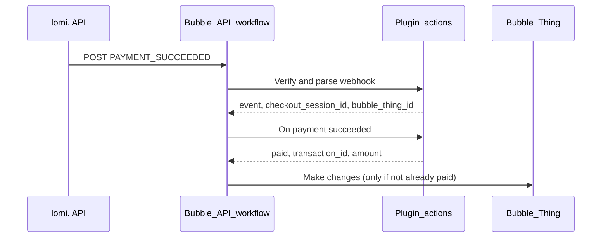

# Webhook workflow (Bubble)

Bubble has no PHP webhook endpoint. Use a **Backend workflow** exposed as an API to receive lomi. webhooks — same events as WooCommerce (`PAYMENT_SUCCEEDED`, `REFUND_COMPLETED`).

## Prerequisites

1. **Plugins → lomi.** — webhook secret for Development (test) and Production (live).
2. **lomi. dashboard** — webhook URL pointing at your Bubble API workflow.
3. Metadata on every checkout session (`bubble_thing_id`, `bubble_thing_type`) from **Create checkout session**.

## 1. Create the API workflow

1. **Backend workflows** → New workflow → name e.g. `lomi_webhook`.
2. **Expose as a public API workflow** (POST).
3. Copy the workflow URL — use the **test** app URL in Development and **live** app URL in Production.

### Dashboard webhook URLs

| Environment | Bubble app | Example |
|-------------|------------|---------|
| Test | `version-test` | `https://yourapp.bubbleapps.io/version-test/api/1.1/wf/lomi_webhook` |
| Live | production | `https://yourapp.bubbleapps.io/api/1.1/wf/lomi_webhook` |

Use the exact URL from Bubble’s API workflow panel (custom domains differ).

## 2. Workflow steps



### Step A — Verify and parse

**Action:** *Plugins → lomi. → Verify and parse webhook*

| Field | Value |
|-------|--------|
| `raw_body` | Request data’s raw body |
| `signature` | Request header `X-Lomi-Signature` |
| `event_header` | Request header `X-Lomi-Event` (optional) |

Stop the workflow if this step errors (invalid signature).

### Step B — Branch on event

| `Result of step A's event` | Next step |
|----------------------------|-----------|
| `PAYMENT_SUCCEEDED` | On payment succeeded (below) |
| `REFUND_COMPLETED` | On refund completed (below) |
| Other | End or log |

### Step C — On payment succeeded

**Action:** *Plugins → lomi. → On payment succeeded*

| Field | Value |
|-------|--------|
| `checkout_session_id` | `Result of step A's checkout_session_id` |
| `event` | `PAYMENT_SUCCEEDED` (optional guard) |

Returns `paid = yes`, `transaction_id`, `amount`, `metadata_json`, `bubble_thing_id`.

### Step D — Update your Thing (idempotency)

1. **Search for** Thing where `unique id` = `Result of step C's bubble_thing_id` (or your metadata field).
2. **Only when** `payment_status` ≠ `paid` (or equivalent):
   - Set `payment_status` = `paid`
   - Store `transaction_id`, `checkout_session_id`
   - Schedule confirmation email / next workflow

Repeat webhook delivery is safe if you gate on status.

## 3. Refund path (`REFUND_COMPLETED`)

**Action:** *Plugins → lomi. → On refund completed*

| Field | Value |
|-------|--------|
| `raw_body` | Request data’s raw body |
| `event_header` | `X-Lomi-Event` |

Use returned `bubble_thing_id` to find the Thing and:

- Set `payment_status` = `refunded` (or add an order note)
- Notify customer if your app supports it

WooCommerce adds an order note; Bubble builders typically append to a `notes` text field or trigger a notification workflow.

## 4. Success page vs webhook

| Path | When |
|------|------|
| **Success URL** + *Complete if paid* | User returns from checkout — fast UX |
| **Webhook** + *On payment succeeded* | User closes tab or network drops before redirect |

Implement **both**. Webhook is authoritative; success page is a safety net for immediate UI.

## 5. Metadata contract

Enforced by **Create checkout session**:

```json
{
  "plugin": "bubble-lomi",
  "bubble_thing_type": "Order",
  "bubble_thing_id": "<unique id>",
  "bubble_page": "checkout",
  "bubble_app_version": "live"
}
```

Search Things by `bubble_thing_id` in webhook workflows (same role as `wc_order_id` in Woo).

## 6. Troubleshooting

| Issue | Fix |
|-------|-----|
| Signature always invalid | Pass **raw** body string, not parsed JSON |
| Thing not found | Ensure `bubble_thing_id` was set at session creation |
| Double payment emails | Add idempotency check on Thing status |
| Test events on live app | Separate webhook URLs and secrets per environment |

See also [SETUP.md](./SETUP.md) for checkout and abandon flows.
